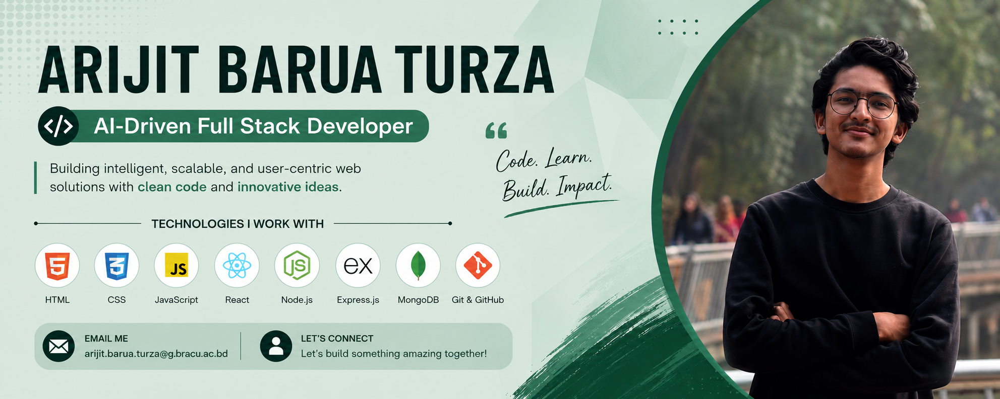

  

<h1 align="center">Hi 👋, I'm ARIJIT BARUA TURZA</h1>

<h3 align="center">
  Building scalable web applications from Bangladesh
</h3>

  

---

## 👨‍💻 About Me

- 🔭 I’m currently working on **AI-powered full-stack web applications**
- 🌱 I’m currently learning **HTML, CSS, JavaScript, React, TypeScript**
- 👯 I’m looking to collaborate on **open-source web development and AI projects**
- 🤝 I’m looking for help with **advanced system design, cloud deployment & scalable architectures**
- 💬 Ask me about **Python, REST APIs, Git/GitHub & web development**
- 📫 How to reach me: **arijit.barua.turza@g.bracu.ac.bd**
- ⚡ Fun fact: **I enjoy turning “this should be easy” into a full-stack project.**

---

## 🤝 Connect with Me

  

  

---

## 🛠️ Technology Stack

### Programming Languages

      

### Frontend Development

    

### Backend Development

   

### Databases

   

### Machine Learning & AI

   

### Design & Graphics

  

 

---

<!-- GITHUB PERFORMANCE -->

📊 GITHUB PERFORMANCE
GitHub Contributions

  

## 📊 GitHub Stats

  

  

  

---

  ⭐ If you like my work, consider giving my repositories a star!

